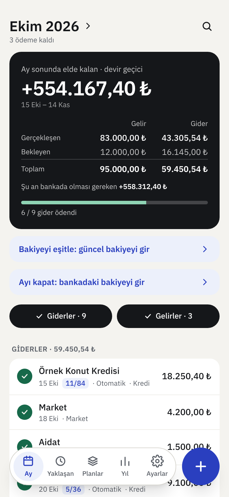
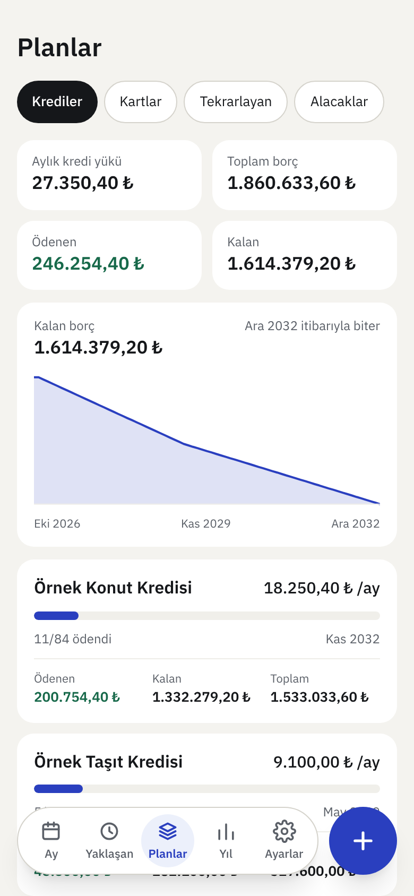
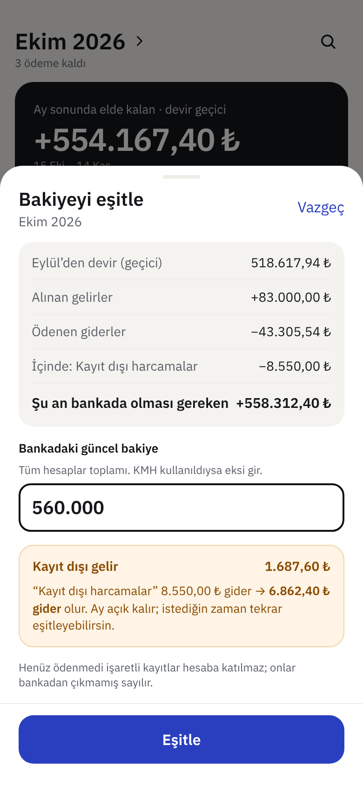
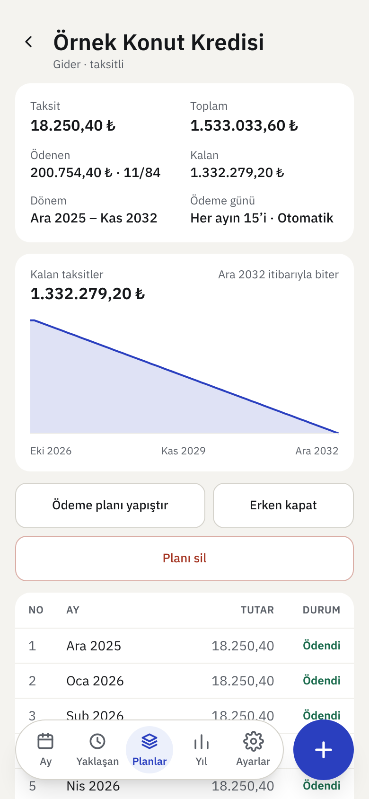
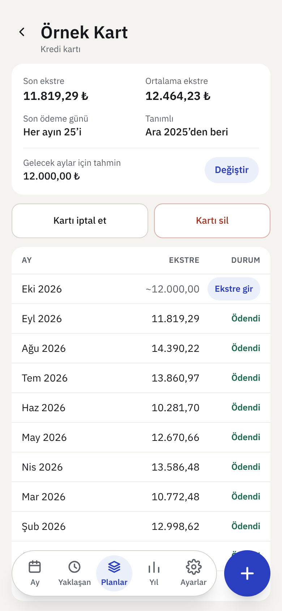
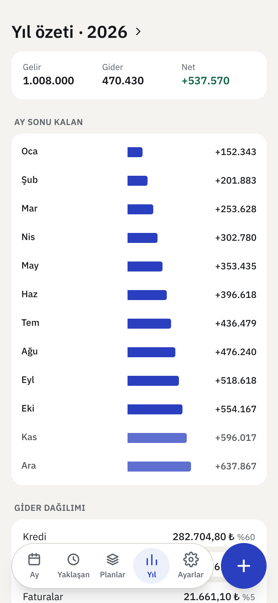
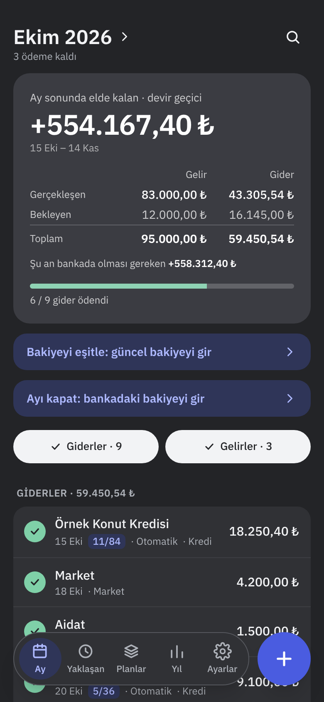
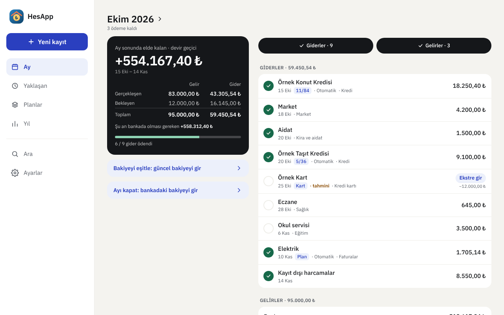

# HesApp

**English** | [Türkçe](README.tr.md)

A simple, mobile-first household income, expense, and installment tracking app.

HesApp runs on your own domain using Cloudflare's free tier (Workers + D1). Sign-in uses **passkeys**: no passwords and no email; each person authenticates with their device's fingerprint, face recognition, or PIN.

It replaces spreadsheet-based monthly tracking by automating recurring entries, installment counters, and date adjustments. Your data stays yours and can be exported at any time as a full JSON backup or Excel workbook.

  
  
  

More screens

| Loan details | Credit card | Year summary | Dark theme |
|---|---|---|---|
|  |  |  |  |

> All names and amounts in the screenshots are fictional sample data generated by pnpm seed.

## Features

- **Period view:** income and expense list, carry-over balance, end-of-period summary, paid status, automatic-payment labels, and estimated vs. actual amounts.
- **Flexible budget periods:** use calendar months or start each period on your salary day.
- **Plans:** recurring monthly items and installment plans for income or expenses, including loan repayment schedules, early payoff, and total/paid/remaining amounts.
- **Credit cards:** monthly statement tracking, editable forecasts, statement history, and quick statement entry from the month view.
- **Scoped edits:** change only one entry, this and future entries, or all entries while preserving paid items and closed periods.
- **Upcoming payments**, **year summary**, category breakdowns, and **change history** showing who changed what.
- **Credit-card line items:** optionally record individual purchases and installments while keeping the statement total as the expense amount.
- **Categories and search**, quick add from recent items, remaining-debt charts, and household-member filters.
- **Due-date notifications:** notify users about payments due the next day.
- **Balance reconciliation and month closing:** reconcile your app balance with your bank balance and automatically track unrecorded spending.
- **Backup and migration:** full JSON backup/restore, Excel export, and an Excel import wizard.
- Light/dark/system themes, installable PWA support, household invitations, and multiple devices per user.

For detailed design decisions and field rules, see [docs/PLAN.md](docs/PLAN.md).

## Quick usage guide

1. On first launch, set your opening balance and budget-period start day.
2. Use **Add (+)** to create a one-time entry, recurring monthly plan, or installment plan.
3. Mark payments as paid as you complete them. Variable amounts such as card statements can start as estimates and later be replaced with actual amounts.
4. Use **Reconcile balance** whenever needed to align the app with your current bank balance.
5. At month end, use **Close month** to finalize the carry-over balance.
6. Import an older Excel file from **Settings → Import from Excel** if needed.

## Development

Requirements: Node.js 22+ and [pnpm](https://pnpm.io).

~~~sh
pnpm install
cp .dev.vars.example .dev.vars
pnpm dev
~~~

The setup form appears on first launch. The setup code is the SETUP_CODE value in .dev.vars. After setup, run pnpm seed if you want fictional sample data.

Commit messages follow [Conventional Commits](https://www.conventionalcommits.org/).

| Command | Purpose |
|---|---|
| pnpm dev | local D1 migration + Vite + local Worker |
| pnpm test | unit and API tests |
| pnpm typecheck | type checking |
| pnpm build | production build |
| pnpm vapid | generate a VAPID key pair for due-date notifications |
| pnpm seed | load fictional sample data into the local database |

## Deployment on Cloudflare

Prerequisite: your domain's DNS must be managed by Cloudflare.

### 1. Create a D1 database

Open **Storage & databases → D1 → Create database** in the Cloudflare dashboard. Name it hesapp and note its database ID.

### 2. Connect the Worker to GitHub

1. Fork this repository or copy it to your account.
2. Open **Workers & Pages → Create → Import a repository** and select the repository.
3. Under **Settings → Build**, configure:
   - **Build command:** pnpm build
   - **Deploy command:** pnpm run deploy:cf
   - **Build variable:** D1_DATABASE_ID = your D1 database ID

The deploy command applies D1 migrations before deploying the Worker. Every later update to main is built and deployed automatically.

### 3. Add a custom domain

Open **Settings → Domains & Routes → Add → Custom domain** and add a subdomain such as budget.example.com.

workers.dev and preview addresses are intentionally disabled.

### 4. Configure Worker secrets

Under **Settings → Variables and Secrets → Production**, add:

| Name | Value |
|---|---|
| SITE_URL | Your full custom-domain URL, without a trailing slash |
| SETUP_CODE | A random value of at least 32 characters |

Optional values include SESSION_DAYS, MAX_USERS, and RP_ID.

### 5. Initial setup

1. Open the app on your phone.
2. Enter your name, setup code, and device name.
3. Create a passkey using your device authentication.
4. Register at least one additional device for recovery.

### 6. Add household members

Use **Settings → Invite new person**. Invitation links are single-use and valid for 24 hours.

### 7. Due-date notifications

Generate VAPID keys with:

~~~sh
node scripts/vapid.mjs
~~~

Add VAPID_PUBLIC_KEY and VAPID_PRIVATE_KEY as Production secrets. Then enable notifications from the app settings on each device.

The scheduled notification task runs every day at 06:00 UTC (09:00 Istanbul time).

## Backup and migration

- **Full JSON backup:** includes plans, entries, periods, and change history and can be restored later.
- **Excel export:** creates one sheet per month plus a Plans sheet.
- **Database dump:** use the Wrangler D1 export command for a SQL backup.
- User accounts and passkeys are intentionally excluded from application backups.

## Updating

Sync your fork with the upstream repository and merge changes into main. Cloudflare Workers Builds will rebuild and deploy automatically, while deploy:cf applies database migrations.

## Optional Cloudflare Access mode

Instead of passkeys, you can use Cloudflare Zero Trust Access by setting AUTH_MODE=access together with ACCESS_TEAM_DOMAIN, ACCESS_AUD, and ALLOWED_EMAILS.

## Troubleshooting

| Symptom | Solution |
|---|---|
| D1_DATABASE_ID is not defined | Put it under Build variables, not Production runtime variables. |
| Passkey creation fails | SITE_URL must exactly match the custom-domain URL and must not use workers.dev. |
| Setup form does not appear | Setup has already been completed; use an invitation for a new device/user. |
| Home-screen icon or app name is outdated | Remove the app from the Home Screen and add it again. |
| Notification key is missing | Configure VAPID_PUBLIC_KEY and VAPID_PRIVATE_KEY and redeploy. |
| Test notification does not arrive | Check notification permissions, then disable and re-enable notifications in the app. |

## License

[MIT](LICENSE)
