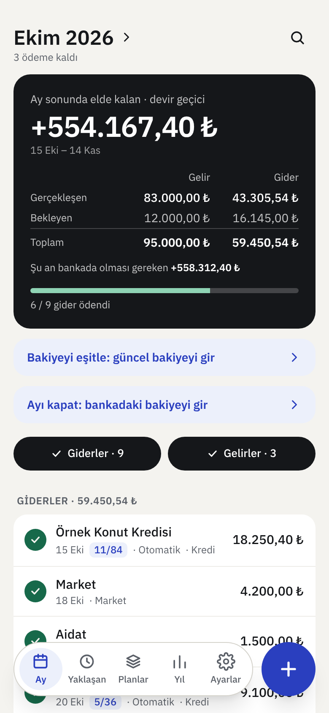
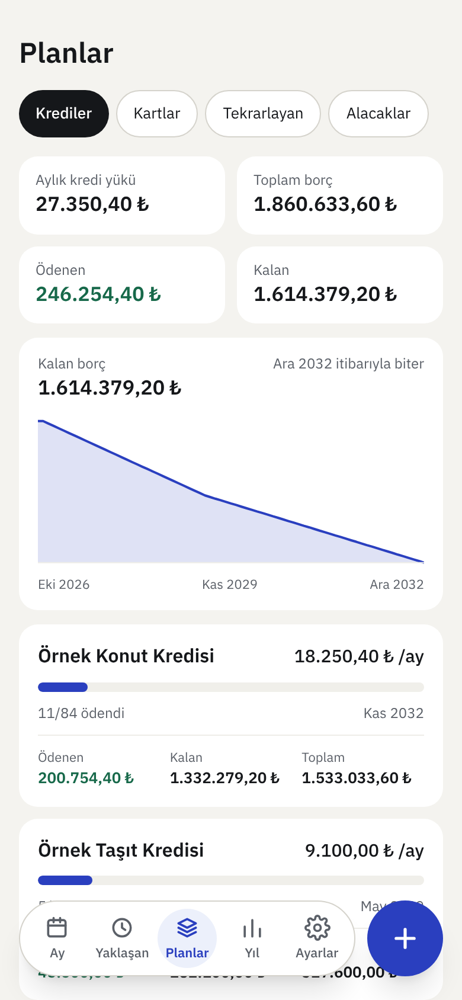
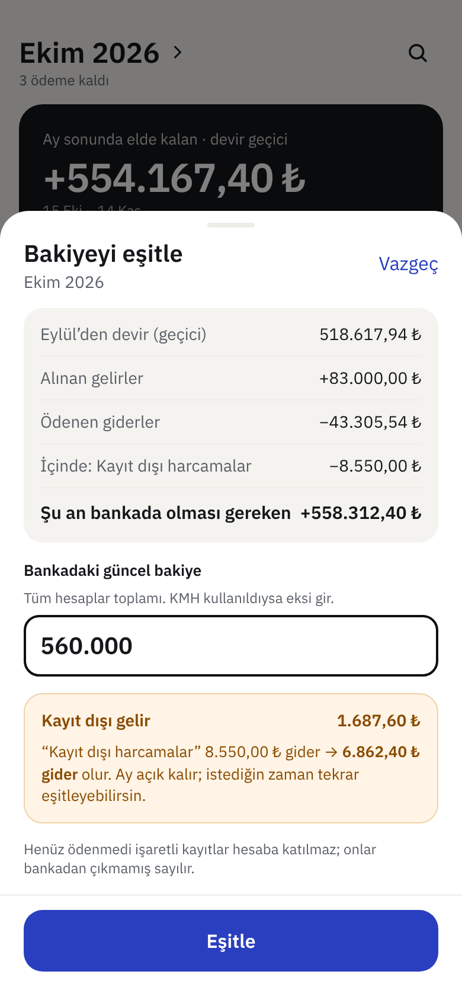
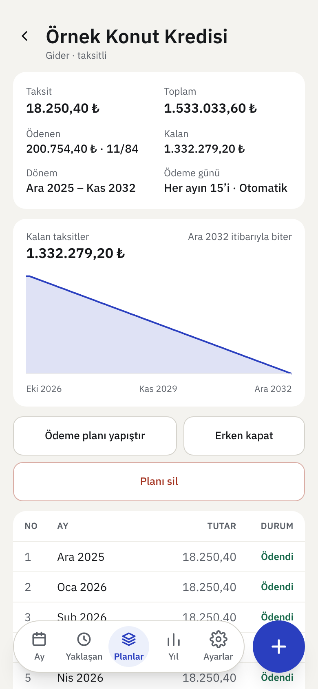
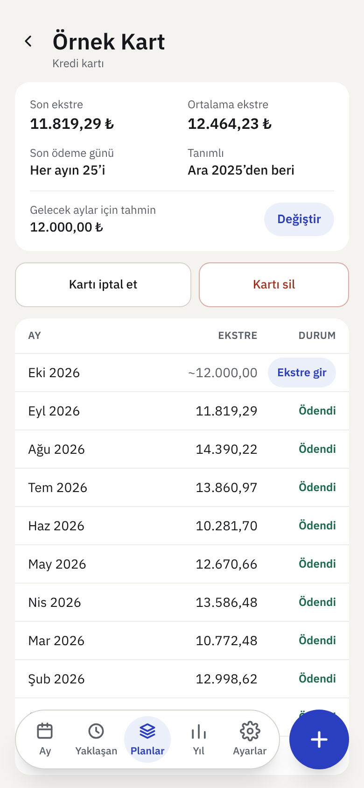
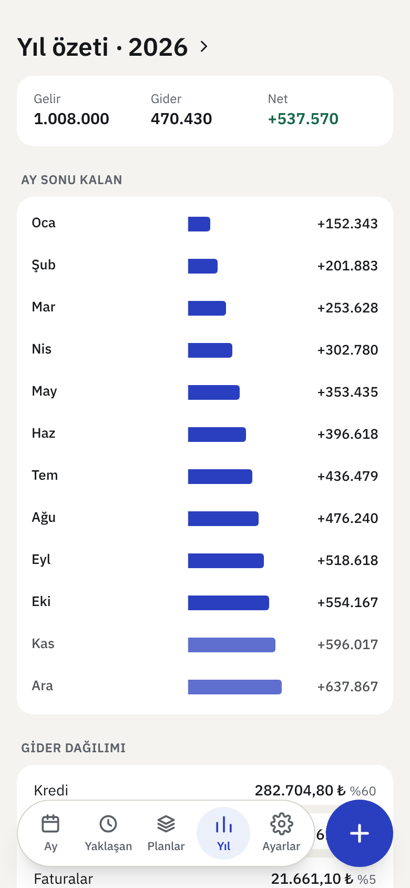
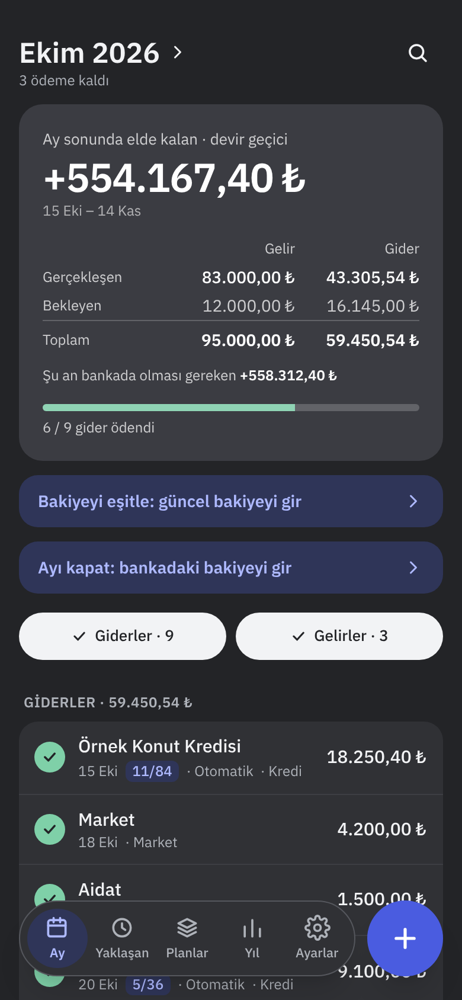
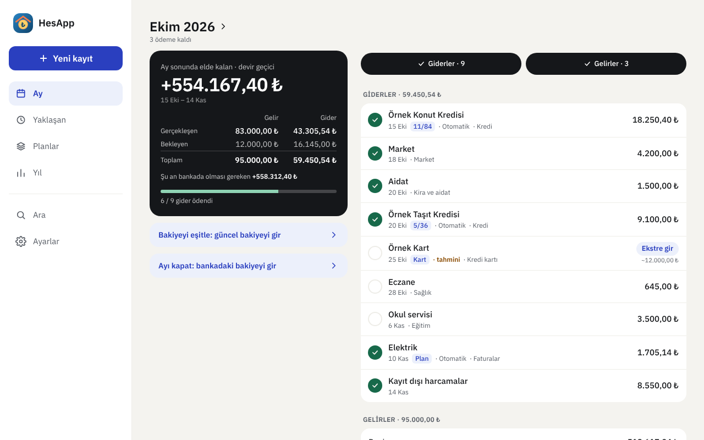

[English](README.md) | **Türkçe**

# HesApp

Hane için basit, mobil öncelikli bir gelir–gider ve taksit takip uygulaması.
Cloudflare'in ücretsiz planında (Workers + D1) kendi alan adınızda çalışır. Giriş **passkey** ile yapılır: parola yok, e-posta yok; her kişi kendi cihazının parmak izi, yüz tanıma ya da PIN doğrulamasını kullanır.

Elektronik tablo ile yapılan aylık takibin yerini alır: taksit sayacı, her ay aynı kalemleri kopyalama ve tarih düzeltme işleri uygulamaya devredilir. Verileriniz sizindir; her an tam yedek ve Excel olarak indirilebilir.

<p align="center">
  
  
  
</p>

<details>
<summary>Diğer ekranlar</summary>

| Kredi detayı | Kredi kartı | Yıl özeti | Koyu tema |
|---|---|---|---|
|  |  |  |  |



</details>

> Ekran görüntülerindeki tüm adlar ve tutarlar uydurmadır (`pnpm seed` örnek verisi).

## Özellikler

- **Dönem ekranı:** gelir/gider listesi, devir, "ay sonunda elde kalan" özeti; gelir ve gider **gerçekleşen** ve **bekleyen** olarak ayrı gösterilir. Ödendi işareti, otomatik ödeme etiketi, tahmini tutar. Bütçe dönemi takvim ayı olabilir ya da maaş gününüze göre ayın 15'inde (1–28) başlayabilir.
- **Planlar:** tekrarlayan (her ay) ve taksitli kalemler; gelir veya gider yönünde. Kredi ödeme planını bankadan yapıştırma, erken kapatma, plan detayında taksit tablosu; her planda toplam, ödenen ve kalan tutar.
- **Kredi kartları:** her ay değişen ekstre için kart tanımı; ay ekranında tek dokunuşla "Ekstre gir", kart detayında son ve ortalama ekstre, gelecek aylar için düzenlenebilir tahmin ve "Kartı iptal et".
- **Düzenleme kapsamı:** bir kaydı "sadece bu", "bu ve sonrakiler" ya da "tümü" için değiştirme; ödenmiş ve kapanmış dönemler korunur.
- **Yaklaşan ödemeler**, **yıl özeti** (kategori dağılımıyla) ve kim neyi değiştirdi gösteren **değişiklik geçmişi**.
- **Kart ekstresi kalemleri:** bir giderin içine isteğe bağlı olarak harcamaları (tarih ve taksitle) girebilirsiniz; tutar yine ekstre toplamıdır, kalemler yalnızca dökümdür.
- **Kategori ve arama**, son kullanılan kalemlerle **hızlı ekleme**, kredilerde **kalan borç grafiği**, hanede **kim ekledi** süzgeci.
- **Vade bildirimi:** vadesi ertesi gün olan ödemeler her sabah 09:00'da telefona bildirilir (kurulum: aşağıda).
- **Bakiye eşitleme ve ay kapanışı:** ay içinde istediğiniz kadar "Bakiyeyi eşitle" ile bankadaki güncel bakiyeyi girersiniz; fark "Kayıt dışı harcamalar" kalemine eklenir. Ay sonunda **Ayı kapat** aynı kalemi günceller ve sonraki ayın devrini kesinleştirir. Son kapatılan ay yeniden açılabilir; kapalı aylara sonradan eksik plan kayıtları eklenip yanlış kayıtlar silinebilir (kapanış bakiyesi korunur).
- **Yedek ve taşıma:** JSON tam yedek (geri yüklenebilir), Excel dışa aktarma ve eski Excel dosyaları için içe aktarma sihirbazı.
- Açık/koyu/sistem teması, ana ekrana eklenebilir (PWA), birkaç kişilik hane için davet ve çoklu cihaz.

Ayrıntılı tasarım kararları ve alan kuralları için [`docs/PLAN.md`](docs/PLAN.md).

## Kullanım özeti

1. **İlk açılışta** Ay ekranındaki "Başlangıç bakiyesini ve dönem gününü ayarla" satırından dönem başlangıç gününü ve bankadaki güncel bakiyeyi girin (sonradan Ayarlar → Bütçe'den de yapılır).
2. **Ekle (+)** ile tek seferlik kayıt, her ay tekrarlayan ya da taksitli plan oluşturun. Geçmişe dönük bir kredi girerken "geçmiş taksitleri ödendi say" kutusunu işaretleyin.
3. Ödemeleri yaptıkça satırın solundaki daireye dokunarak **ödendi** işaretleyin. Kart ekstresi gibi her ay değişen tutarlar "tahmini" doğar; ekstre gelince **gerçekleşen** tutarı girin.
4. Ay içinde dilediğiniz zaman **Bakiyeyi eşitle** ile bankadaki güncel bakiyeyi girin; kayıtlara geçmemiş harcamalar "Kayıt dışı harcamalar" kalemine eklenir.
5. Ay sonunda **Ayı kapat**: bankadaki toplam bakiyeyi girin. Kalan fark aynı kaleme eklenir ve bir sonraki ay bu bakiyeyle devreder.
6. Eski bir Excel dosyanız varsa **Ayarlar → Excel'den içe aktar** ile aylara dağıtın.

## Geliştirme

Gereksinimler: Node.js 22+, [pnpm](https://pnpm.io).

```sh
pnpm install
cp .dev.vars.example .dev.vars   # yerel ayarlar (depoya girmez)
pnpm dev                         # http://localhost:5173
```

İlk açılışta kurulum formu çıkar; kurulum kodu `.dev.vars` içindeki `SETUP_CODE` değeridir. Dolu bir ekranla denemek için kurulumdan sonra `pnpm seed` çalıştırın (örnek kredi, maaş ve kart kalemleri; yalnızca yerel veritabanını etkiler).

Commit mesajları [Conventional Commits](https://www.conventionalcommits.org/) biçimindedir (başlık küçük harf, Türkçe); kural yerel bir git kancasıyla denetlenir. Ayrıntı: [`docs/PLAN.md`](docs/PLAN.md), bölüm 13.

| Komut | İş |
|---|---|
| `pnpm dev` | yerel D1 migration'ı + Vite + yerel Worker |
| `pnpm test` | birim ve API testleri (sanal passkey cihazı, gerçek D1 benzetimi) |
| `pnpm typecheck` | tip denetimi |
| `pnpm build` | üretim derlemesi |
| `pnpm vapid` | vade bildirimi için VAPID anahtar çifti üretir (kurulumsuz: `node scripts/vapid.mjs`) |
| `pnpm seed` | yerel veritabanına uydurma örnek veri yükler (önce `pnpm db:migrate:local`) |

## Kurulum (kendi Cloudflare hesabınızda)

Önkoşul: alan adınızın DNS'i Cloudflare'de olmalı.

### 1. D1 veritabanını oluşturun

Cloudflare paneli → **Storage & databases → D1 → Create database**. Adı `hesapp` olsun. Oluşan veritabanının **ID** değerini not edin.

### 2. Worker'ı GitHub'a bağlayın (Workers Builds)

1. Depoyu çatallayın (fork) ya da kendi hesabınıza kopyalayın.
2. **Workers & Pages** → **Create** → **Import a repository**; GitHub hesabınızı bağlayıp depoyu seçin. Proje adı `wrangler.jsonc` içindeki `name` ile aynı olmalıdır (`hesapp`).
3. Proje → **Settings → Build**:
   - **Build command:** `pnpm build`
   - **Deploy command:** `pnpm run deploy:cf`
   - **Build variables** (derleme sırasında okunan değişkenler): `D1_DATABASE_ID` = 1. adımdaki ID. Bu değer depoya yazılmaz; derlemede `wrangler.jsonc`'ye eklenir.

> **Dikkat: iki ayrı değişken bölümü var.** *Build variables*, yalnızca derleme sırasında görünür. Çalışan uygulamanın okuduğu değişkenler (`SITE_URL`, `SETUP_CODE` gibi, 4. adım) Worker'ın **Settings → Variables and Secrets** bölümündeki **Production** değişkenleridir. Birini diğerine girmek "değişken tanımlı değil" hatası verir.

> İki komutu karıştırmayın: *Build command* alanına `pnpm run deploy:cf` yazılırsa `pnpm build` hiç çalışmaz, veritabanı kimliği yazılmaz ve migration yer tutucu kimlikle başarısız olur.

`deploy:cf` komutu önce veritabanı şemasını günceller (`wrangler d1 migrations apply`), sonra yayınlar.
Sonraki her `main` güncellemesi otomatik derlenip yayına çıkar.

### 3. Alan adı bağlayın

Worker → **Settings → Domains & Routes → Add → Custom domain** ile bir alt alan adı ekleyin (ör. `butce.ornek.com`).
`workers.dev` ve önizleme adresleri bilerek kapalıdır.

### 4. Worker değişkenlerini girin

Worker → **Settings → Variables and Secrets** → **Production** (Build bölümü değil; tür: **Secret**):

| Ad | Değer |
|---|---|
| `SITE_URL` | `https://butce.ornek.com` (3. adımdaki adres, sonunda `/` olmadan) |
| `SETUP_CODE` | parola yöneticinizle ürettiğiniz en az 32 karakterlik rastgele değer |

İsteğe bağlı: `SESSION_DAYS` (varsayılan 30), `MAX_USERS` (varsayılan 5), `RP_ID` (varsayılan: `SITE_URL` alan adı).

### 5. İlk kurulum

1. Adresi telefonunuzda açın. Kurulum formu çıkar.
2. Adınızı, `SETUP_CODE` değerini ve cihaz adını girip **Passkey oluştur**'a dokunun; cihazınızın doğrulamasını (parmak izi/yüz/PIN) tamamlayın.
3. Kurulum bittikten sonra `SETUP_CODE` değişkenini silebilirsiniz; ilk kullanıcıdan sonra kurulum zaten kapanır.
4. En az ikinci bir cihazınızı **Ayarlar → Bu cihazı ekle** ile kaydedin (telefon kaybına karşı).

### 6. Başka kişileri ekleyin

**Ayarlar → Yeni kişi davet et**: kişinin adını yazın, üretilen bağlantıyı yalnızca o kişiyle paylaşın (24 saat geçerli, tek kullanımlık). Kişi bağlantıyı kendi telefonunda açıp kendi passkey'ini oluşturur.

### 7. Vade bildirimi (isteğe bağlı)

1. Bilgisayarınızda depo klasöründe `node scripts/vapid.mjs` çalıştırın (Node.js 20+ yeterli, paket kurulumu gerekmez; `pnpm vapid` de aynı işi yapar ama önce paketleri kurar). İki satır çıkar: `VAPID_PUBLIC_KEY` ve `VAPID_PRIVATE_KEY`.
2. Worker → **Settings → Variables and Secrets** → **Production** bölümüne ikisini de **Secret** türünde girin. İsterseniz `VAPID_SUBJECT=mailto:adresiniz` ekleyin (verilmezse `SITE_URL` kullanılır). Anahtarları depoya yazmayın; özel anahtarı değiştirirseniz herkesin bildirimleri yeniden açması gerekir.
3. Her telefonda **Ayarlar → Vade bildirimi → Bildirimleri aç**, ardından **Deneme gönder** ile kontrol edin. iPhone'da önce uygulamayı ana ekrana ekleyip oradan açmak gerekir.

Zamanlanmış görev `wrangler.jsonc` içindeki `triggers` ile gelir (her gün 06:00 UTC = 09:00 İstanbul); ayrıca bir şey kurmanız gerekmez.

### Cihaz kaybı ve kurtarma

- **Bir üye cihazını kaybederse:** hesap sahibi Ayarlar'dan kişiyi çıkarıp yeniden davet eder. Kişi birden fazla cihaz kaydettiyse kaybolan cihazın anahtarını Ayarlar'dan silmesi yeterli.
- **Hesap sahibi tüm cihazlarını kaybederse:** Cloudflare hesabına erişen kişi kimlik tablolarını sıfırlayıp kurulumu yeniden yapar (bütçe verisi korunur):

  ```sh
  pnpm wrangler d1 execute DB --remote --command "DELETE FROM users"
  ```

  Ardından `SETUP_CODE` değişkenini yeniden girip adres 5. adımdaki gibi kurulur.

## Yedekleme ve veriyi taşıma

- **Ayarlar → Tam yedek indir (JSON):** tüm planlar, kayıtlar, aylar ve değişiklik geçmişi. **Yedekten geri yükle** ile aktarılır; uygulamada zaten veri varsa onayınızla mevcut bütçe verisi silinip yedekle değiştirilir (yazma başarısız olursa önceki veri korunur). Kullanıcı hesapları ve passkey'ler yedeğe girmez; yeni kurulumda yeniden oluşturulur.
- **Ayarlar → Excel olarak indir:** her ay bir sayfa, ayrıca "Planlar" sayfası. Uygulama kapansa bile okunabilir.
- **Veritabanı dökümü:** `pnpm wrangler d1 export hesapp --remote --output yedek.sql`
- Düzenli yedek için JSON yedeğini ayda bir indirip güvenli bir yerde saklamanız önerilir.

## Güncelleme

Çatalınızı (fork) ana depoyla eşitleyip `main`'e birleştirdiğinizde Workers Builds otomatik derler ve yayınlar; veritabanı şeması `deploy:cf` komutuyla güncellenir. Yeni sürümlerde yedek biçimi sürümlüdür, eski yedekler geri yüklenebilir.

## İsteğe bağlı: Cloudflare Access modu

Passkey yerine kendi kimlik sağlayıcınızı (Cloudflare Zero Trust Access) kullanmak isterseniz Worker değişkenlerine `AUTH_MODE=access`, `ACCESS_TEAM_DOMAIN`, `ACCESS_AUD` ve `ALLOWED_EMAILS` girin. Bu modda passkey uçları kapalıdır, uygulama `Cf-Access-Jwt-Assertion` başlığını doğrular. Ayrıntı: [`docs/PLAN.md`](docs/PLAN.md), bölüm 10.

## Sorun giderme

| Belirti | Çözüm |
|---|---|
| Derleme "D1_DATABASE_ID tanımlı değil" diyor | Değişken *Build variables* bölümüne girilmeli (4. adımdaki Production değişkenleri değil). |
| Passkey oluşturulamıyor | `SITE_URL` tam adresle (`https://…`, sonunda `/` yok) eşleşmeli; adres `workers.dev` değil, bağladığınız özel alan adı olmalı. |
| Kurulum formu çıkmıyor, giriş ekranı geliyor | Kurulum zaten yapılmış. Cihazınız kayıtlı değilse hesap sahibinden davet isteyin. |
| Ana ekrandaki simge ya da ad eski kaldı | Uygulamayı ana ekrandan kaldırıp yeniden ekleyin. |
| Ayarlar'da "bildirim anahtarı tanımlı değil" yazıyor | 7. adımdaki `VAPID_PUBLIC_KEY` ve `VAPID_PRIVATE_KEY` girilmemiş; girdikten sonra yeni sürümün yayınlanmasını bekleyin. |
| `pnpm vapid` ya da başka bir komut `ERR_PNPM_MINIMUM_RELEASE_AGE_VIOLATION` veriyor | pnpm 11, son 24 saatte yayınlanmış paketleri kurmaz. Anahtar için `node scripts/vapid.mjs` kullanın; kurulum bir gün sonra kendiliğinden geçer. |
| Deneme bildirimi gelmiyor | Telefonun ayarlarında tarayıcının (ya da uygulamanın) bildirim izni açık olmalı; Ayarlar'dan bildirimleri kapatıp yeniden açın. |

## Lisans

[MIT](LICENSE)
